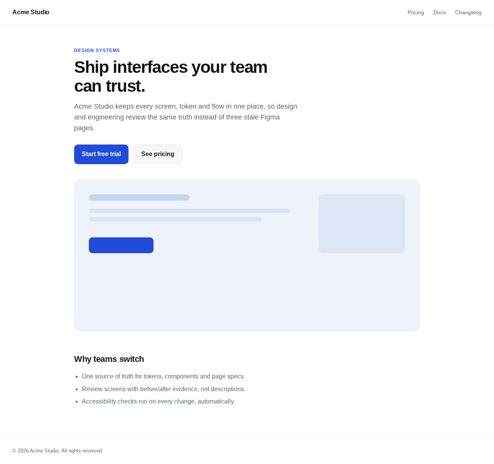
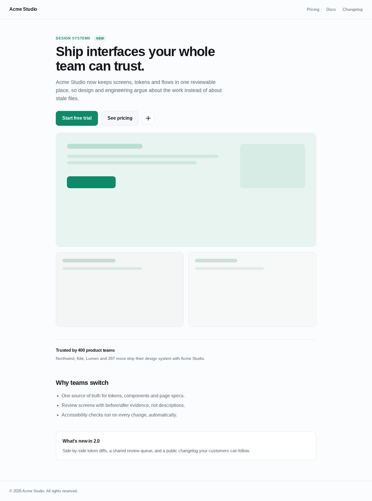
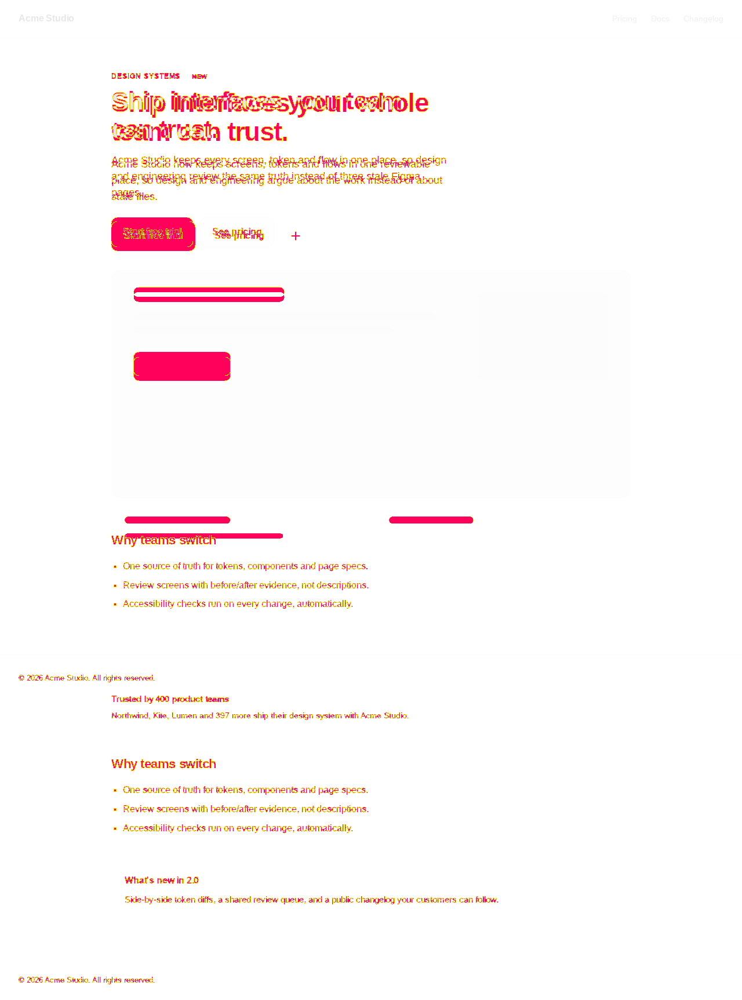

<!-- proofshot:report -->
## 📸 proofshot

**1 changed · 1 unchanged · 0 failed** · **1 a11y regressions** — `demo/before` → `demo/after`

2 route(s) × 1 viewport(s) · threshold 0.10% · routes from CLI --routes

| Route | Viewport | Pixel diff | a11y | Console | Status |
| --- | --- | --- | --- | --- | --- |
| `/` | desktop | **2.32%** | ⚠️ +4 | 0 → 1 | 🔴 changed |
| `/pricing` | desktop | **0%** | ✅ 0 | 0 | 🟢 unchanged |

Evidence — before / after / diff, and what got worse

### `/` · desktop — 2.32% changed

| Before | After | Diff |
| --- | --- | --- |
|  |  |  |

_Screenshot size changed (before 1280×1204 → after 1280×1725); the shorter capture is padded with the page background for the diff._

a11y counts — images 0 · buttons 0 · links 0 · fields 0 · headings 0 · console 0
→ images 1 · buttons 1 · links 0 · fields 0 · headings 1 · console 1

**New issues**

- `img-alt` `section.hero:nth-of-type(1) > div.shot-row:nth-of-type(2) > img:nth-of-type(1)` — image has no alt attribute
- `button-name` `section.hero:nth-of-type(1) > div.actions:nth-of-type(1) > button.icon-only:nth-of-type(2)` — button has no accessible name
- `heading-order` `main > section.logos:nth-of-type(2) > h3` — heading jumps from h1 to h3
- `console-error` `console` — Acme Studio: GET /api/tokens returned 500

Generated 2026-11-21T14:15:21.085Z by [proofshot](https://github.com/developjik/proofshot) · base source `demo/before` · head source `demo/after`
